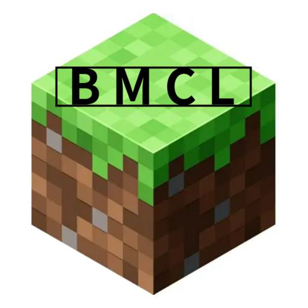
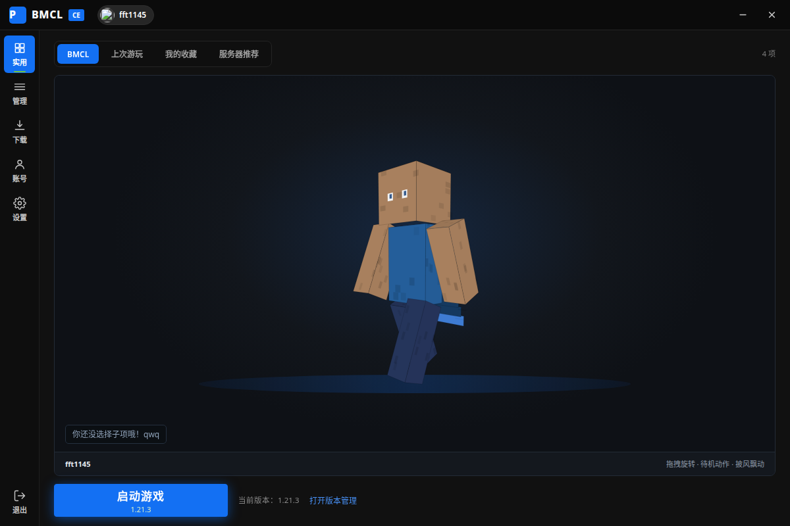
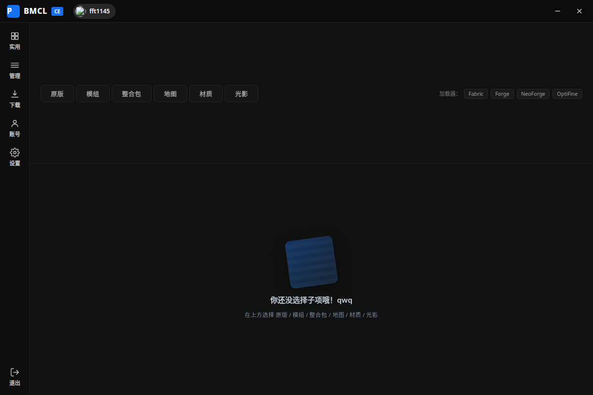
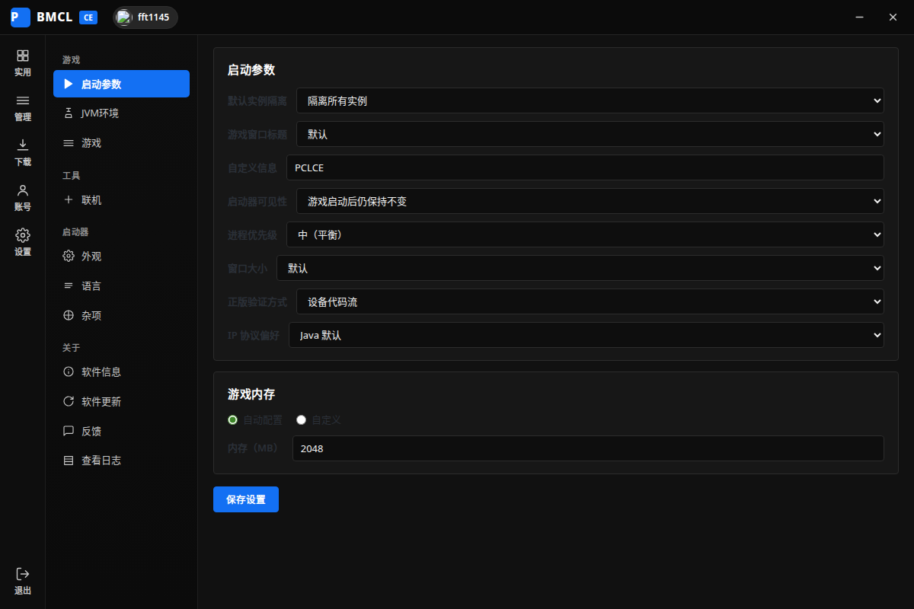

**简体中文** | [官方网站](https://bmcl26.netlify.app)

<div align="center">



# BMCL

**Better Minecraft Launcher** · 基于 PCL2 交互思路的 Minecraft 启动器

[](https://github.com/fft1145/BMCL/stargazers)


[](https://github.com/fft1145/BMCL/issues)


<br />

[立即下载](https://github.com/fft1145/BMCL/releases/latest) |
[官方网站](https://bmcl26.netlify.app) |
[源码包](https://github.com/fft1145/BMCL/archive/refs/tags/v2.2.5.zip)

[提交问题](https://github.com/fft1145/BMCL/issues/new/choose) |
[更新日志](https://github.com/fft1145/BMCL/releases) |
[公告与通知](https://bmcl26.netlify.app/notices.json)

</div>

BMCL（Better Minecraft Launcher）是一个完全本地运行的 Minecraft 启动器，交互沿用 PCL2 的使用习惯，不需要登录、也不依赖任何自建服务器，下载、安装、启动全部在你的电脑上完成。

内置原版与整合包下载、模组与套件安装、账户与皮肤管理、Java 与内存配置，以及自更新、崩溃自检等日常功能；界面按 PCL2 的布局重新绘制，熟悉 PCL2 的用户可以无缝上手。

## 💻 支持平台

| 操作系统 | 支持情况 | 环境要求 |
|---|---|---|
| Windows 11 | ✅ 完整支持 | 无需额外安装运行库 |
| Windows 10 1809 (17763) 或更高 | ✅ 完整支持 | 无需额外安装运行库 |
| Windows 7 / 8 / 8.1 | ❌ 不支持 | 需升级系统（Electron 33 已不再支持） |
| macOS / Linux | ⚠️ 仅开发调试 | 可编译并运行源码，不提供成品 |

**✅ 完整支持**：尽可能提供一切相关支持，建议始终使用最新版本。

**❌ 不支持**：这些系统上启动器无法运行，请升级操作系统后再使用。

**⚠️ 仅开发调试**：可以拉取源码自行构建调试，但不作为正式发布平台，也不提供社区支持。

## ✨ 主要功能

- **实例管理**：多实例并存，独立版本、模组、存档与配置，互不干扰。
- **资源下载**：原版、模组、整合包、地图、材质、光影分类下载，支持 Forge / Fabric / NeoForge / OptiFine 一键安装。
- **账户系统**：微软正版登录与离线账户，皮肤管理与 4D 实时渲染预览。
- **Java 与内存**：自动扫描本机 Java，也可手动指定路径与启动参数。
- **镜像加速**：下载源可在官方与 BMCLAPI 镜像之间切换。
- **陶瓦联机**：内置 Terracotta / EasyTier，输入大厅编号即可与好友联机，无需端口映射。
- **自动更新**：从 GitHub Releases 检查更新，只覆盖启动器自身文件。
- **崩溃自检**：启动器异常退出或游戏崩溃时自动读取日志并给出诊断建议。
- **公告下发**：官网后台发布的公告会在启动器内同步展示。

## 📦 下载与安装

| 渠道 | 说明 |
|---|---|
| [GitHub Releases](https://github.com/fft1145/BMCL/releases/latest) | 最新便携版 `Better-MC-Launcher.exe`，解压即用 |
| [官方网站](https://bmcl26.netlify.app/#download) | 国内访问更稳定的下载页，附校验信息 |
| [源码包](https://github.com/fft1145/BMCL/archive/refs/tags/v2.2.5.zip) | 当前版本完整源码，供自行构建 |

启动器为免安装的便携版，首次运行会在自己的数据目录中初始化，不会改动你已有的 `.minecraft`。

## 🖼️ 界面预览

<div align="center">



</div>

## 🚀 从源码运行

```bash
npm install
npm start        # 启动 GUI（窗口标题 fft1145）
npm test         # 运行核心模块单元测试（无需 Electron）
npm run dist     # 打包 Windows 便携版
```

## 🔒 安全约定

1. 更新只覆盖启动器自身文件（`main.js`、`preload.js`、`package.json`、
   `src/`、`renderer/`、`launcher-version.json`），**绝不覆盖游戏文件**。
   更新器在执行前会逐个校验路径，任何 `.minecraft`、`saves`、`mods`、
   `versions`、`libraries`、`options.txt` 等游戏内容都会被拒绝。
2. 游戏数据默认放在启动器自己的数据目录（`<userData>/game`），
   不会碰你已有的 `.minecraft`。可在「设置」里修改游戏目录。
3. 更新检查使用 GitHub Releases，下载源可选官方或 BMCLAPI 镜像。

## 📊 统计数据

[](https://star-history.com/#fft1145/BMCL&Date)

**此页浏览量**（总计 / 今日）：[](https://hits.zkitefly.eu.org/?tag=https://github.com/fft1145/BMCL&web=true)

## ❤️ 贡献者

感谢所有为 BMCL 提供建议、反馈问题与提交代码的朋友。

[查看贡献者列表](https://github.com/fft1145/BMCL/graphs/contributors)

## 📄 许可证

本仓库暂未附带开源许可证文件。除另有说明外，代码与资源保留所有权利，公开可见仅供学习与参考；如需商业使用或二次分发，请先联系作者获得授权。

---

**相关链接**：[官方网站](https://bmcl26.netlify.app) · [问题反馈](https://github.com/fft1145/BMCL/issues) · [版本发布](https://github.com/fft1145/BMCL/releases) · [爱发电](https://afdian.com/a/fft1145)
