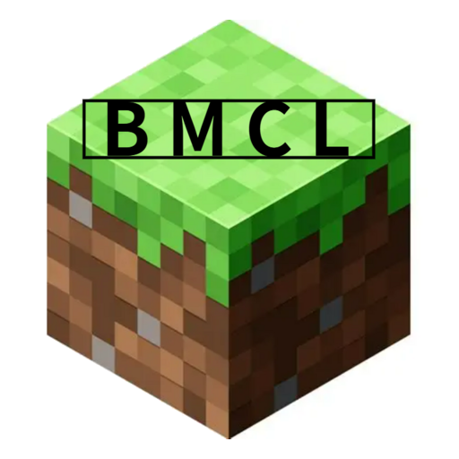

[简体中文](README.md) | [繁體中文（香港／澳門）](README.zh-HK.md) | [繁體中文（台灣）](README.zh-TW.md) | [English (USA)](README.en-US.md) | [English (UK)](README.en-GB.md) | [English (Australia)](README.en-AU.md) | [日本語](README.ja-JP.md) | [**Deutsch**](README.de-DE.md) | [Offizielle Website](https://bmcl26.netlify.app)

<div align="center">



# BMCL

**Better Minecraft Launcher** · Ein Minecraft-Launcher nach dem Bedienkonzept von PCL2

[](https://github.com/fft1145/BMCL/stargazers)


<br />

[Herunterladen](https://github.com/fft1145/BMCL/releases/latest) |
[Offizielle Website](https://bmcl26.netlify.app) |
[Quellarchiv](https://github.com/fft1145/BMCL/archive/refs/tags/v2.6.8.zip)

[Problem melden](https://github.com/fft1145/BMCL/issues/new/choose) |
[Änderungsprotokoll](https://github.com/fft1145/BMCL/releases)

</div>

BMCL (Better Minecraft Launcher) ist ein vollständig lokal laufender Minecraft-Launcher, der die Bedienung von PCL2 übernimmt. Kein Login und kein eigener Server: Herunterladen, Installieren und Starten passieren auf deinem PC.

Enthalten sind Vanilla- und Modpack-Downloads, Mod- und Loader-Installation, Konto- und Skin-Verwaltung, Java- und Arbeitsspeicher-Einstellungen sowie Selbst-Update und Absturzdiagnose.

## 💻 Unterstützte Systeme

| Betriebssystem | Unterstützung | Voraussetzungen |
|---|---|---|
| Windows 11 | ✅ Vollständig | Keine zusätzlichen Runtimes |
| Windows 10 1809 (17763) oder neuer | ✅ Vollständig | Keine zusätzlichen Runtimes |
| Windows 7 / 8 / 8.1 | ❌ Nicht unterstützt | Bitte aktualisieren (Electron 33 nicht mehr unterstützt) |
| macOS / Linux | ⚠️ Nur Entwicklung | Quellcode baubar, keine fertigen Builds |

## ✨ Funktionen

- **Instanzverwaltung**: Mehrere Instanzen mit eigenen Versionen, Mods, Welten und Einstellungen.
- **Ressourcen-Download**: Vanilla, Mods, Modpacks, Karten, Texturen und Shader, inklusive Ein-Klick-Installation von Forge / Fabric / NeoForge / OptiFine.
- **Konten**: Microsoft-Anmeldung und Offline-Konten, Skin-Verwaltung mit Echtzeit-3D-Vorschau.
- **Java und Arbeitsspeicher**: Automatische Java-Erkennung, Pfad und JVM-Argumente manuell einstellbar.
- **Mirror-Beschleunigung**: Umschalten zwischen offizieller Quelle und BMCLAPI.
- **Terracotta-Mehrspieler**: Terracotta / EasyTier integriert — Lobby-Code eingeben und mit Freunden spielen, ohne Portfreigabe.
- **Automatische Updates**: Prüft GitHub Releases und ersetzt nur Launcher-Dateien.
- **Absturzdiagnose**: Liest Logs und gibt Hinweise, wenn Launcher oder Spiel abstürzen.
- **Ankündigungen**: Auf der Website veröffentlichte Hinweise erscheinen im Launcher.

## 📦 Download und Installation

| Quelle | Beschreibung |
|---|---|
| [GitHub Releases](https://github.com/fft1145/BMCL/releases/latest) | Aktuelle portable `Better-MC-Launcher.exe`, entpacken und starten |
| [Offizielle Website](https://bmcl26.netlify.app/#download) | Download-Seite mit Prüfsummen |
| [Quellarchiv](https://github.com/fft1145/BMCL/archive/refs/tags/v2.6.8.zip) | Vollständiger Quellcode der aktuellen Version |

BMCL ist portabel. Beim ersten Start wird ein eigenes Datenverzeichnis angelegt; dein vorhandenes `.minecraft` bleibt unberührt.

## 🚀 Aus dem Quellcode starten

```bash
npm install
npm start        # GUI starten
npm test         # Unit-Tests der Kernmodule (ohne Electron)
npm run dist     # portables Windows-Paket bauen
```

## 🔒 Sicherheitsregeln

1. Updates ersetzen nur Launcher-Dateien (`main.js`, `preload.js`, `package.json`,
   `src/`, `renderer/`, `launcher-version.json`) und **niemals** Spieldateien.
   `.minecraft`, `saves`, `mods`, `versions`, `libraries` und `options.txt` werden abgelehnt.
2. Spieldaten liegen standardmäßig im eigenen Datenverzeichnis (`<userData>/game`).
3. Update-Prüfungen nutzen GitHub Releases; Downloads laufen über die offizielle Quelle oder BMCLAPI.

## 📄 Lizenz

Veröffentlicht unter der [Apache License 2.0](LICENSE), derselben Lizenz wie PCL CE.

---

**Links**: [Offizielle Website](https://bmcl26.netlify.app) · [Issues](https://github.com/fft1145/BMCL/issues) · [Releases](https://github.com/fft1145/BMCL/releases) · [Afdian](https://afdian.com/a/fft1145)
