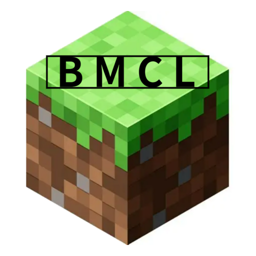

[简体中文](README.md) | [繁體中文（香港／澳門）](README.zh-HK.md) | [繁體中文（台灣）](README.zh-TW.md) | [English (USA)](README.en-US.md) | [**English (UK)**](README.en-GB.md) | [English (Australia)](README.en-AU.md) | [日本語](README.ja-JP.md) | [Deutsch](README.de-DE.md) | [Official Website](https://bmcl26.netlify.app)

<div align="center">



# BMCL

**Better Minecraft Launcher** · A Minecraft launcher built around the PCL2 workflow

[](https://github.com/fft1145/BMCL/stargazers)


<br />

[Download now](https://github.com/fft1145/BMCL/releases/latest) |
[Official website](https://bmcl26.netlify.app) |
[Source archive](https://github.com/fft1145/BMCL/archive/refs/tags/v2.6.1.zip)

[Report an issue](https://github.com/fft1145/BMCL/issues/new/choose) |
[Changelog](https://github.com/fft1145/BMCL/releases)

</div>

BMCL (Better Minecraft Launcher) is a fully local Minecraft launcher that follows the PCL2 interaction model. No sign-in and no self-hosted server: downloading, installing and launching all happen on your own machine.

It bundles vanilla and modpack downloads, mod and loader installation, account and skin management, Java and memory configuration, plus self-update and crash self-check.

## 💻 Supported platforms

| OS | Support | Requirements |
|---|---|---|
| Windows 11 | ✅ Full support | No extra runtimes needed |
| Windows 10 1809 (17763) or later | ✅ Full support | No extra runtimes needed |
| Windows 7 / 8 / 8.1 | ❌ Not supported | Please upgrade (Electron 33 dropped support) |
| macOS / Linux | ⚠️ Development only | Source can be built, no binaries provided |

## ✨ Features

- **Instance management**: Multiple instances with independent versions, mods, worlds and settings.
- **Resource download**: Vanilla, mods, modpacks, maps, textures and shaders, with one-click Forge / Fabric / NeoForge / OptiFine installation.
- **Accounts**: Microsoft sign-in and offline accounts, skin management with a real-time 3D preview.
- **Java and memory**: Automatic Java detection, or specify a path and JVM arguments manually.
- **Mirror acceleration**: Switch between the official source and the BMCLAPI mirror.
- **Terracotta multiplayer**: Built-in Terracotta / EasyTier — enter a lobby code and play with friends, no port forwarding.
- **Automatic updates**: Checks GitHub Releases and only replaces launcher files.
- **Crash self-check**: Reads logs and gives diagnostic advice when the launcher or game crashes.
- **Announcements**: Notices published on the website appear inside the launcher.

## 📦 Download and install

| Channel | Description |
|---|---|
| [GitHub Releases](https://github.com/fft1145/BMCL/releases/latest) | Latest portable `Better-MC-Launcher.exe`, unpack and run |
| [Official website](https://bmcl26.netlify.app/#download) | Faster download page with checksums |
| [Source archive](https://github.com/fft1145/BMCL/archive/refs/tags/v2.6.1.zip) | Full source for the current version |

BMCL is portable. On first launch it initialises its own data directory and never touches your existing `.minecraft`.

## 🚀 Run from source

```bash
npm install
npm start        # launch the GUI
npm test         # run core unit tests (no Electron needed)
npm run dist     # build the Windows portable package
```

## 🔒 Safety rules

1. Updates only replace launcher files (`main.js`, `preload.js`, `package.json`,
   `src/`, `renderer/`, `launcher-version.json`) and **never** game files.
   Every path is validated first; `.minecraft`, `saves`, `mods`, `versions`,
   `libraries` and `options.txt` are rejected.
2. Game data lives in the launcher's own data directory (`<userData>/game`) by default.
3. Update checks use GitHub Releases; downloads can use the official source or BMCLAPI.

## 📄 Licence

Licensed under the [Apache License 2.0](LICENSE), the same licence as PCL CE.

---

**Links**: [Official website](https://bmcl26.netlify.app) · [Issues](https://github.com/fft1145/BMCL/issues) · [Releases](https://github.com/fft1145/BMCL/releases) · [Afdian](https://afdian.com/a/fft1145)
