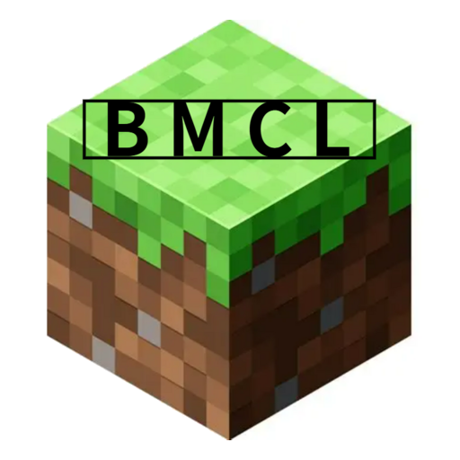
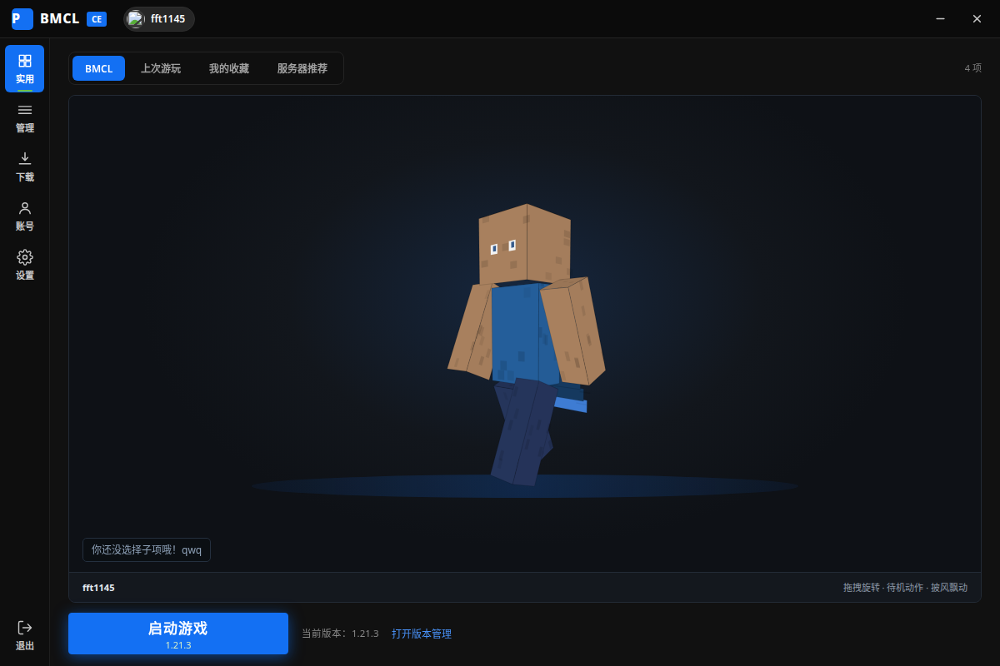
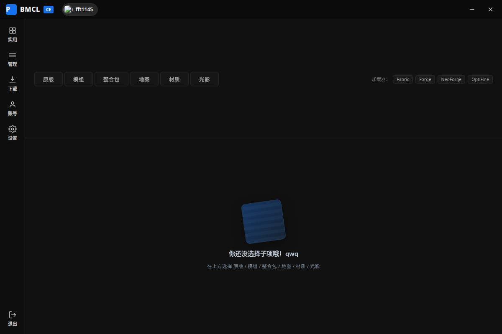
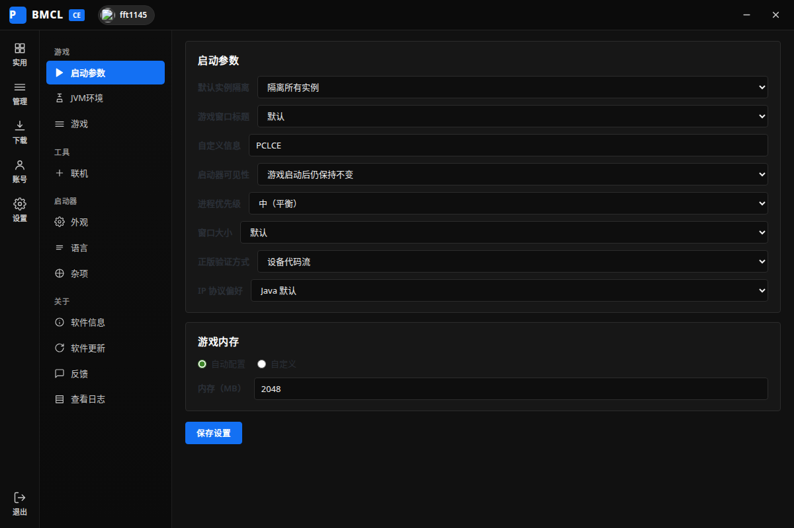

[简体中文](README.md) | [繁體中文（香港／澳門）](README.zh-HK.md) | [繁體中文（台灣）](README.zh-TW.md) | [English (US)](README.en-US.md) | [**English (USA)**](README.en-USA.md) | [Official Website](https://bmcl26.netlify.app)

<div align="center">



# BMCL

**Better Minecraft Launcher** · A Minecraft launcher that keeps the PCL2 workflow

[](https://github.com/fft1145/BMCL/stargazers)


[](https://github.com/fft1145/BMCL/issues)


<br />

[Download](https://github.com/fft1145/BMCL/releases/latest) |
[Official Website](https://bmcl26.netlify.app) |
[Source Code](https://github.com/fft1145/BMCL/archive/refs/tags/v2.3.0.zip)

[Report an Issue](https://github.com/fft1145/BMCL/issues/new/choose) |
[Release Notes](https://github.com/fft1145/BMCL/releases) |
[Notices](https://bmcl26.netlify.app/notices.json)

</div>

BMCL (Better Minecraft Launcher) is a fully local Minecraft launcher. It follows the PCL2 workflow, requires no sign-in, and depends on no self-hosted server — downloading, installing, and launching all happen on your own machine.

It ships with vanilla and modpack downloads, mod and loader installation, account and skin management, Java and memory configuration, plus self-update and crash self-check. The interface is rebuilt around the PCL2 layout, so existing PCL2 users can pick it up right away.

## 💻 Supported Platforms

| OS | Status | Requirements |
|---|---|---|
| Windows 11 | ✅ Fully supported | No extra runtime needed |
| Windows 10 1809 (17763) or newer | ✅ Fully supported | No extra runtime needed |
| Windows 7 / 8 / 8.1 | ❌ Not supported | Please upgrade (Electron 33 no longer supports them) |
| macOS / Linux | ⚠️ Development only | Sources build and run, no prebuilt release |

**✅ Fully supported**: everything we can reasonably support is supported; always use the latest version.

**❌ Not supported**: the launcher cannot run on these systems. Please upgrade your OS first.

**⚠️ Development only**: you can build and debug from source, but it is not a release target and comes without community support.

## ✨ Features

- **Instance management**: multiple instances side by side, each with its own versions, mods, saves, and settings.
- **Resource downloads**: vanilla, mods, modpacks, maps, resource packs, and shaders, with one-click Forge / Fabric / NeoForge / OptiFine installation.
- **Accounts**: Microsoft account sign-in and offline accounts, skin management, and a 4D real-time preview.
- **Java and memory**: automatic detection of installed Java, plus manual paths and JVM arguments.
- **Mirror acceleration**: switch download sources between the official servers and BMCLAPI.
- **Terracotta multiplayer**: built-in Terracotta / EasyTier — enter a lobby ID and play with friends, no port forwarding.
- **Auto-update**: checks GitHub Releases and only replaces the launcher's own files.
- **Crash self-check**: reads logs and suggests a diagnosis when the game or launcher crashes.
- **Announcements**: notices published from the website backend show up inside the launcher.

## 📦 Download & Installation

| Channel | Description |
|---|---|
| [GitHub Releases](https://github.com/fft1145/BMCL/releases/latest) | Latest portable `Better-MC-Launcher.exe`, unzip and run |
| [Official Website](https://bmcl26.netlify.app/#download) | More stable download page in mainland China, with checksums |
| [Source Code](https://github.com/fft1145/BMCL/archive/refs/tags/v2.3.0.zip) | Full source for the current version |

The launcher is portable and needs no installation. On first run it initializes its own data directory and never touches your existing `.minecraft`.

## 🖼️ Screenshots

<div align="center">



</div>

## 🚀 Run from Source

```bash
npm install
npm start        # launch the GUI (window title: BMCL)
npm test         # run core unit tests (no Electron required)
npm run dist     # build the Windows portable package
```

## 🔒 Security Notes

1. Updates only replace the launcher's own files (`main.js`, `preload.js`, `package.json`,
   `src/`, `renderer/`, `launcher-version.json`) and **never overwrite game files**.
   The updater validates every path first and rejects anything under `.minecraft`,
   `saves`, `mods`, `versions`, `libraries`, or `options.txt`.
2. Game data lives in the launcher's own data directory (`<userData>/game`) by default,
   so your existing `.minecraft` is left alone. You can change the game directory in Settings.
3. Update checks use GitHub Releases; the download source can be official servers or the BMCLAPI mirror.

## 📊 Statistics

[](https://star-history.com/#fft1145/BMCL&Date)

**Page views** (total / today): [](https://hits.zkitefly.eu.org/?tag=https://github.com/fft1145/BMCL&web=true)

## ❤️ Contributors

Thanks to everyone who has suggested features, reported bugs, and contributed code to BMCL.

[View contributors](https://github.com/fft1145/BMCL/graphs/contributors)

## 📄 License

This project is licensed under the [Apache License 2.0](LICENSE), the same license used by PCL CE.

You are free to use, modify, and distribute it, including commercially, as long as you keep the [LICENSE](LICENSE) file and copyright notice and state your changes when redistributing.

---

**Links**: [Official Website](https://bmcl26.netlify.app) · [Issues](https://github.com/fft1145/BMCL/issues) · [Releases](https://github.com/fft1145/BMCL/releases) · [Afdian](https://afdian.com/a/fft1145)
