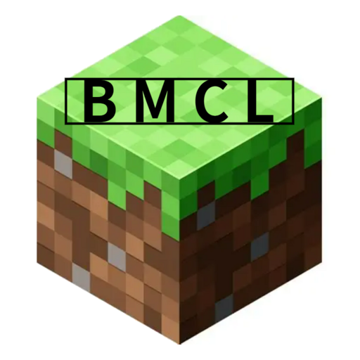

[简体中文](README.md) | [繁體中文（香港／澳門）](README.zh-HK.md) | [繁體中文（台灣）](README.zh-TW.md) | [English (USA)](README.en-US.md) | [English (UK)](README.en-GB.md) | [English (Australia)](README.en-AU.md) | [**日本語**](README.ja-JP.md) | [Deutsch](README.de-DE.md) | [公式サイト](https://bmcl26.netlify.app)

<div align="center">



# BMCL

**Better Minecraft Launcher** · PCL2 の操作感を再現した Minecraft ランチャー

[](https://github.com/fft1145/BMCL/stargazers)


<br />

[ダウンロード](https://github.com/fft1145/BMCL/releases/latest) |
[公式サイト](https://bmcl26.netlify.app) |
[ソースアーカイブ](https://github.com/fft1145/BMCL/archive/refs/tags/v2.6.8.zip)

[不具合報告](https://github.com/fft1145/BMCL/issues/new/choose) |
[更新履歴](https://github.com/fft1145/BMCL/releases)

</div>

BMCL（Better Minecraft Launcher）は、PCL2 の操作感を踏襲した完全ローカル動作の Minecraft ランチャーです。ログインも独自サーバーも不要で、ダウンロード・インストール・起動はすべてお使いの PC 上で完結します。

バニラ／MOD パックのダウンロード、MOD とローダーの導入、アカウントとスキンの管理、Java とメモリの設定に加え、自動更新やクラッシュ自己診断を備えています。

## 💻 対応環境

| OS | 対応 | 必要条件 |
|---|---|---|
| Windows 11 | ✅ 完全対応 | 追加のランタイム不要 |
| Windows 10 1809 (17763) 以降 | ✅ 完全対応 | 追加のランタイム不要 |
| Windows 7 / 8 / 8.1 | ❌ 非対応 | システムのアップグレードが必要（Electron 33 が非対応） |
| macOS / Linux | ⚠️ 開発・デバッグのみ | ソースからビルド可能、ビルド済み配布なし |

## ✨ 主な機能

- **インスタンス管理**：複数インスタンスを並存させ、バージョン・MOD・ワールド・設定を個別に保持。
- **リソースのダウンロード**：バニラ、MOD、MOD パック、マップ、テクスチャ、シェーダーに対応。Forge / Fabric / NeoForge / OptiFine をワンクリック導入。
- **アカウント**：Microsoft ログインとオフラインアカウント、スキン管理、リアルタイム 3D プレビュー。
- **Java とメモリ**：Java を自動検出。パスや JVM 引数の手動指定も可能。
- **ミラー加速**：公式ソースと BMCLAPI ミラーを切り替え可能。
- **Terracotta マルチプレイ**：Terracotta / EasyTier 内蔵。ロビー番号を入力するだけでフレンドと遊べ、ポート開放は不要。
- **自動更新**：GitHub Releases を確認し、ランチャー本体のファイルのみを更新。
- **クラッシュ自己診断**：ランチャーやゲームの異常終了時にログを読み、対処案を表示。
- **お知らせ**：公式サイトで公開されたお知らせをランチャー内に表示。

## 📦 ダウンロードとインストール

| 配布元 | 内容 |
|---|---|
| [GitHub Releases](https://github.com/fft1145/BMCL/releases/latest) | 最新のポータブル版 `Better-MC-Launcher.exe` |
| [公式サイト](https://bmcl26.netlify.app/#download) | チェックサム付きのダウンロードページ |
| [ソースアーカイブ](https://github.com/fft1145/BMCL/archive/refs/tags/v2.6.8.zip) | 現行バージョンの全ソース |

BMCL はインストール不要のポータブル版です。初回起動時に専用データフォルダーを初期化し、既存の `.minecraft` には触れません。

## 🚀 ソースから実行

```bash
npm install
npm start        # GUI を起動
npm test         # コアのユニットテスト（Electron 不要）
npm run dist     # Windows ポータブル版をビルド
```

## 🔒 安全ポリシー

1. 更新はランチャー本体のファイル（`main.js`、`preload.js`、`package.json`、
   `src/`、`renderer/`、`launcher-version.json`）のみを置き換え、**ゲームファイルは上書きしません**。
   `.minecraft`、`saves`、`mods`、`versions`、`libraries`、`options.txt` は拒否されます。
2. ゲームデータは既定で専用データフォルダー（`<userData>/game`）に保存されます。
3. 更新確認は GitHub Releases、ダウンロードは公式または BMCLAPI を利用します。

## 📄 ライセンス

[Apache License 2.0](LICENSE) で公開されています（PCL CE と同じライセンス）。

---

**リンク**：[公式サイト](https://bmcl26.netlify.app) · [Issues](https://github.com/fft1145/BMCL/issues) · [Releases](https://github.com/fft1145/BMCL/releases) · [Afdian](https://afdian.com/a/fft1145)
