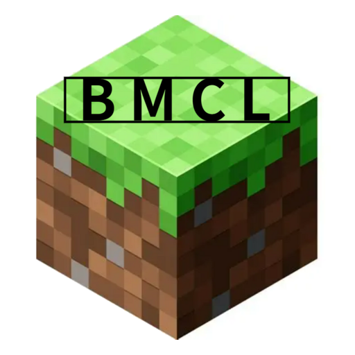
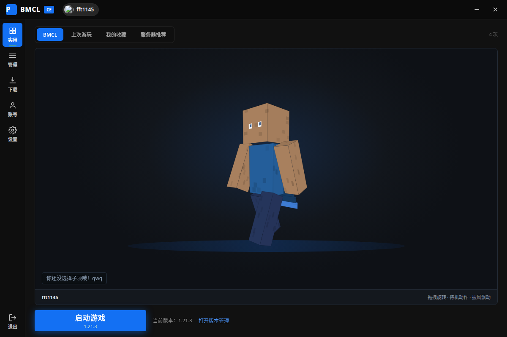
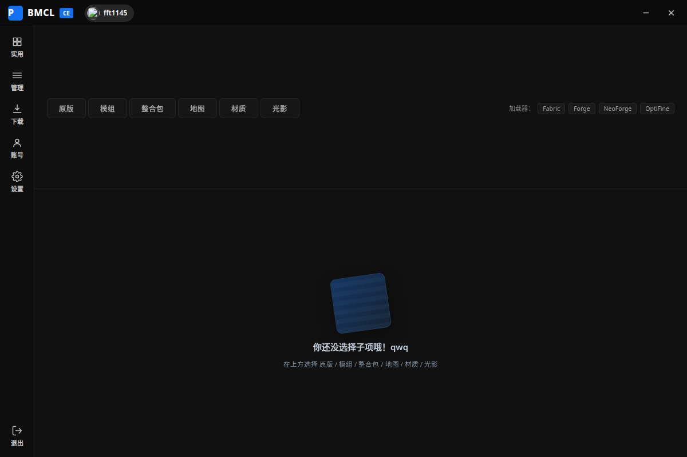
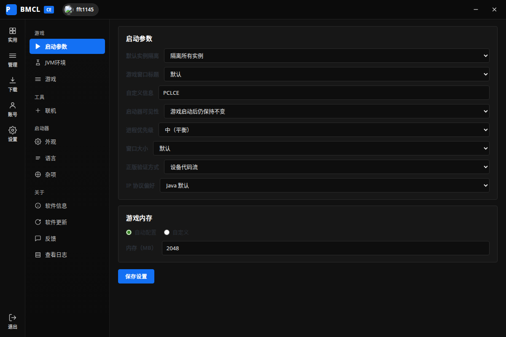

[简体中文](README.md) | [繁體中文（香港／澳門）](README.zh-HK.md) | [**繁體中文（台灣）**](README.zh-TW.md) | [English (USA)](README.en-US.md) | [English (UK)](README.en-GB.md) | [English (Australia)](README.en-AU.md) | [日本語](README.ja-JP.md) | [Deutsch](README.de-DE.md) | [官方網站](https://bmcl26.netlify.app)

<div align="center">



# BMCL

**Better Minecraft Launcher** · 沿用 PCL2 操作習慣的 Minecraft 啟動器

[](https://github.com/fft1145/BMCL/stargazers)


[](https://github.com/fft1145/BMCL/issues)


<br />

[立即下載](https://github.com/fft1145/BMCL/releases/latest) |
[官方網站](https://bmcl26.netlify.app) |
[原始碼包](https://github.com/fft1145/BMCL/archive/refs/tags/v2.6.4.zip)

[回報問題](https://github.com/fft1145/BMCL/issues/new/choose) |
[更新日誌](https://github.com/fft1145/BMCL/releases) |
[公告與通知](https://bmcl26.netlify.app/notices.json)

</div>

BMCL（Better Minecraft Launcher）是一個完全在本機執行的 Minecraft 啟動器，操作習慣沿用 PCL2，不需要登入，也不依賴任何自架伺服器，下載、安裝、啟動全部在你的電腦上完成。

內建原版與整合包下載、模組與套件安裝、帳號與外觀管理、Java 與記憶體設定，以及自動更新、崩潰自檢等日常功能；介面依 PCL2 的版面重新繪製，熟悉 PCL2 的玩家可以無縫上手。

## 💻 支援平台

| 作業系統 | 支援情況 | 環境需求 |
|---|---|---|
| Windows 11 | ✅ 完整支援 | 無需額外安裝執行庫 |
| Windows 10 1809 (17763) 或更新 | ✅ 完整支援 | 無需額外安裝執行庫 |
| Windows 7 / 8 / 8.1 | ❌ 不支援 | 需升級系統（Electron 33 已不再支援） |
| macOS / Linux | ⚠️ 僅供開發除錯 | 可編譯並執行原始碼，不提供成品 |

**✅ 完整支援**：盡可能提供一切相關支援，建議始終使用最新版本。

**❌ 不支援**：啟動器無法在這些系統上執行，請升級作業系統後再使用。

**⚠️ 僅供開發除錯**：可以取得原始碼自行建置除錯，但不作為正式發佈平台，也不提供社群支援。

## ✨ 主要功能

- **實例管理**：多個實例並存，獨立版本、模組、存檔與設定，互不干擾。
- **資源下載**：原版、模組、整合包、地圖、材質、光影分類下載，支援 Forge / Fabric / NeoForge / OptiFine 一鍵安裝。
- **帳號系統**：Microsoft 正版登入與離線帳號，外觀管理與 4D 即時渲染預覽。
- **Java 與記憶體**：自動掃描本機 Java，也可手動指定路徑與啟動參數。
- **鏡像加速**：下載來源可在官方與 BMCLAPI 鏡像之間切換。
- **陶瓦聯機**：內建 Terracotta / EasyTier，輸入大廳編號即可與好友聯機，無需連接埠轉送。
- **自動更新**：從 GitHub Releases 檢查更新，只覆蓋啟動器自身檔案。
- **崩潰自檢**：啟動器異常結束或遊戲崩潰時，自動讀取日誌並給出診斷建議。
- **公告發佈**：官網後台發佈的公告會在啟動器內同步顯示。

## 📦 下載與安裝

| 渠道 | 說明 |
|---|---|
| [GitHub Releases](https://github.com/fft1145/BMCL/releases/latest) | 最新免安裝版 `Better-MC-Launcher.exe`，解壓即用 |
| [官方網站](https://bmcl26.netlify.app/#download) | 國內存取較穩定的下載頁，附校驗資訊 |
| [原始碼包](https://github.com/fft1145/BMCL/archive/refs/tags/v2.6.4.zip) | 目前版本的完整原始碼，供自行建置 |

啟動器為免安裝的可攜版，首次執行會在自己的資料目錄中初始化，不會改動你現有的 `.minecraft`。

## 🖼️ 介面預覽

<div align="center">



</div>

## 🚀 從原始碼執行

```bash
npm install
npm start        # 啟動 GUI（視窗標題 BMCL）
npm test         # 執行核心模組單元測試（無需 Electron）
npm run dist     # 打包 Windows 免安裝版
```

## 🔒 安全約定

1. 更新只覆蓋啟動器自身檔案（`main.js`、`preload.js`、`package.json`、
   `src/`、`renderer/`、`launcher-version.json`），**絕不覆蓋遊戲檔案**。
   更新器在執行前會逐一校驗路徑，任何 `.minecraft`、`saves`、`mods`、
   `versions`、`libraries`、`options.txt` 等遊戲內容都會被拒絕。
2. 遊戲資料預設放在啟動器自己的資料目錄（`<userData>/game`），
   不會碰你現有的 `.minecraft`。可在「設定」裡修改遊戲目錄。
3. 更新檢查使用 GitHub Releases，下載來源可選官方或 BMCLAPI 鏡像。

## 📊 統計資料

[](https://star-history.com/#fft1145/BMCL&Date)

**本頁瀏覽量**（總計 / 今日）：[](https://hits.zkitefly.eu.org/?tag=https://github.com/fft1145/BMCL&web=true)

## ❤️ 貢獻者

感謝所有為 BMCL 提供建議、回報問題與提交程式碼的朋友。

[查看貢獻者列表](https://github.com/fft1145/BMCL/graphs/contributors)

## 📄 授權條款

本專案基於 [Apache License 2.0](LICENSE) 開源，與 PCL CE 採用同一授權條款。

你可以自由使用、修改、散佈本專案（包括商業用途），只需在散佈時保留 [LICENSE](LICENSE) 檔案與版權聲明，並說明你作出的修改。

---

**相關連結**：[官方網站](https://bmcl26.netlify.app) · [問題回報](https://github.com/fft1145/BMCL/issues) · [版本發佈](https://github.com/fft1145/BMCL/releases) · [愛發電](https://afdian.com/a/fft1145)
